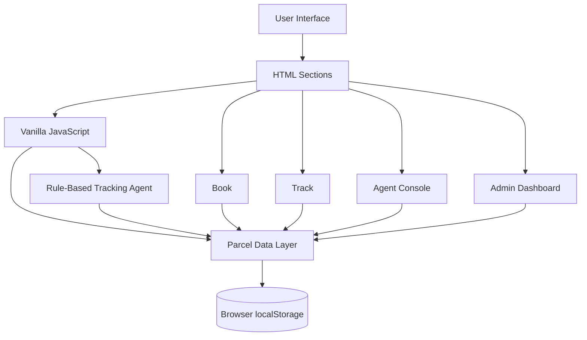

<div align="center">

# SwiftShip Tracker

### AI-Inspired Parcel Booking & Tracking Web Application

A lightweight, single-page logistics prototype for **booking parcels, tracking delivery status, simulating a conversational tracking agent, and monitoring operations** — built entirely with HTML, CSS, and vanilla JavaScript.

<br>


</div>

---

## Overview

**SwiftShip Tracker** is a frontend-only parcel management prototype that demonstrates the complete delivery journey through a single browser-based interface.

Instead of separating booking, tracking, delivery updates, and operational monitoring into different applications, SwiftShip brings them together through four connected views:

- **Book a Parcel** — create a shipment and generate a tracking ID
- **Track** — view the parcel's current delivery stage
- **Agent Console** — advance parcels through the delivery lifecycle
- **Admin Dashboard** — monitor parcel counts and records

The application uses the browser's `localStorage` as its persistence layer. This means the same parcel records are immediately available across all four views without requiring a backend server.

The tracking assistant is currently a **rule-based simulation**, not a real LLM or production AI agent. Its purpose is to demonstrate how a conversational interface could interact with parcel data before connecting the application to a real AI/backend system.

> **Project status:** Functional frontend prototype  
> **Backend:** Not implemented  
> **Database:** Browser localStorage  
> **AI Assistant:** Rule-based simulation  
> **Build system:** Not required

---

## Why SwiftShip?

Traditional parcel workflows often require users to move between booking systems, tracking pages, customer support channels, and operational dashboards.

SwiftShip explores a simpler interaction model:

```text
                    SwiftShip Tracker
                           |
        +------------------+------------------+
        |                  |                  |
      Customer           Delivery           Admin
        |                 Agent               |
        |                  |                  |
     Booking          Status Update      Operations
     Tracking         Parcel Progress    Overview
        |                  |                  |
        +------------------+------------------+
                           |
                    Shared Parcel Data
                      localStorage
```

The prototype demonstrates how these workflows can operate around a **single parcel data model**.

---

# Core Features

## 1. Parcel Booking

Create a parcel by entering:

- Sender name
- Sender address
- Sender phone
- Sender email
- Receiver name
- Receiver address
- Receiver phone
- Receiver email
- Parcel weight
- Estimated delivery date

After submission, SwiftShip generates a tracking ID in the format:

```text
SS-12345
```

The new parcel is immediately stored in the browser and becomes available to the other modules.

---

## 2. Parcel Tracking

Enter a tracking ID to view the current delivery stage.

The application represents the parcel lifecycle as:

```text
Booked
   |
   v
In Transit
   |
   v
Out for Delivery
   |
   v
Delivered
```

The tracking interface visually highlights:

- Completed stages
- Current stage
- Remaining stages
- Sender and receiver information
- Estimated delivery date

---

## 3. Parcel Tracking Agent

The Track view includes a lightweight conversational assistant.

Example queries:

```text
track parcel SS-10234
```

or:

```text
update status of SS-10234 to Delivered
```

The assistant:

1. Detects the tracking ID
2. Searches the stored parcel records
3. Reads the current status
4. Optionally updates the status
5. Saves the modified parcel data
6. Reflects the change in the tracking interface

This is implemented through the `agentReply()` function using rule-based text matching.

### Important

The current assistant is **not a real AI model**. It is a simulation designed to demonstrate the interaction pattern of a future AI-powered logistics assistant.

---

## 4. Delivery Agent Console

The Agent Console provides a delivery-oriented view of all stored parcels.

For each parcel, the agent can:

- View tracking ID
- View sender
- View receiver
- View current status
- Advance the parcel to its next delivery stage

For example:

```text
Booked
  -> Advance
In Transit
  -> Advance
Out for Delivery
  -> Advance
Delivered
```

When a status is advanced, the application displays a notification simulating an email alert to the receiver.

---

## 5. Admin Dashboard

The Admin Dashboard provides an operational overview of the stored parcel records.

It displays:

| Status | Purpose |
|---|---|
| Booked | Newly created shipments |
| In Transit | Parcels moving through the network |
| Out for Delivery | Parcels currently in final delivery |
| Delivered | Completed shipments |

The dashboard also provides a full parcel table containing:

- Tracking ID
- Sender
- Receiver
- Weight
- Estimated delivery date
- Current status

For demonstrations, the dashboard includes:

- **Load Sample Data**
- **Clear All Data**

---

# Architecture

SwiftShip follows a lightweight single-page architecture.



### Application Layers

| Layer | Responsibility |
|---|---|
| Presentation | HTML structure and UI components |
| Styling | CSS layout, themes, responsive behaviour |
| Interaction | JavaScript event handling and view switching |
| Data | Parcel records stored in `localStorage` |
| Assistant | Rule-based conversational parcel lookup/update |

The architecture intentionally isolates data access through:

```javascript
loadParcels()
saveParcels()
```

This makes the prototype easier to migrate to a real API later.

---

# Data Model

Each parcel is represented as a JSON-serialisable JavaScript object.

```javascript
{
  id: "SS-12345",
  status: "In Transit",
  weight: "2.5",
  eta: "2026-10-02",
  booked: "2026-09-29T10:30:00.000Z",

  sender: {
    name: "Sender Name",
    address: "Sender Address",
    phone: "+91 XXXXX XXXXX",
    email: "sender@example.com"
  },

  receiver: {
    name: "Receiver Name",
    address: "Receiver Address",
    phone: "+91 XXXXX XXXXX",
    email: "receiver@example.com"
  }
}
```

### Parcel Status Model

```text
Booked
In Transit
Out for Delivery
Delivered
```

All modules operate on the same parcel collection, creating a consistent source of truth within the browser.

---

# Technology Stack

| Technology | Role |
|---|---|
| HTML5 | Page structure and semantic UI |
| CSS3 | Styling, responsive layout and themes |
| JavaScript | Application logic and interactions |
| Browser localStorage | Client-side parcel persistence |
| Google Fonts | Barlow Condensed, IBM Plex Sans, IBM Plex Mono |

### No Framework Required

SwiftShip does not depend on:

- React
- Angular
- Vue
- Node.js
- Express
- npm packages
- Build tools
- Database servers

The complete prototype is contained in a single HTML file.

---

# Project Structure

```text
SwiftShip-Tracker/
│
├── swiftship.html
└── README.md
```

The `swiftship.html` file contains:

```text
HTML
 ├── Navigation
 ├── Book View
 ├── Track View
 ├── Agent Console
 └── Admin Dashboard

CSS
 ├── Layout
 ├── Responsive Design
 ├── Light/Dark Theme
 ├── Status Components
 └── Tables & Forms

JavaScript
 ├── Parcel Storage
 ├── Booking
 ├── Tracking
 ├── Agent Chat
 ├── Agent Console
 └── Admin Dashboard
```

---

# Getting Started

## Requirements

Only a modern web browser is required.

Recommended browsers:

- Google Chrome
- Microsoft Edge
- Mozilla Firefox
- Safari

No installation or server setup is necessary.

## Run Locally

Clone the repository:

```bash
git clone <YOUR-REPOSITORY-URL>
cd SwiftShip-Tracker
```

Then open:

```text
swiftship.html
```

You can also simply double-click the HTML file and open it in a browser.

---

# Quick Demo

For a complete demonstration:

### Step 1 — Load Sample Data

Open:

```text
Admin → Load Sample Data
```

This creates demonstration parcels in different delivery stages.

### Step 2 — Track a Parcel

Go to:

```text
Track
```

Enter one of the generated tracking IDs.

### Step 3 — Test the Tracking Agent

Try:

```text
track parcel SS-XXXXX
```

You can also test a status update:

```text
update status of SS-XXXXX to Delivered
```

### Step 4 — Test the Agent Console

Open:

```text
Agent Console
```

Advance a parcel through its delivery stages.

### Step 5 — Verify the Admin Dashboard

Return to:

```text
Admin
```

The status counters and parcel table will reflect the updated data.

This demonstrates the complete flow:

```text
Book
  |
  v
Track
  |
  v
Agent Update
  |
  v
Admin Monitoring
```

---

# Key JavaScript Functions

| Function | Responsibility |
|---|---|
| `genId()` | Generates a tracking ID |
| `loadParcels()` | Reads parcel records from localStorage |
| `saveParcels()` | Saves parcel records to localStorage |
| `findParcel()` | Finds a parcel using its tracking ID |
| `renderTrackResult()` | Renders the delivery timeline |
| `agentReply()` | Processes tracking-agent requests |
| `renderAgent()` | Builds the delivery-agent table |
| `renderAdmin()` | Builds dashboard statistics and records |

A major design decision is keeping `loadParcels()` and `saveParcels()` as the main data-access boundary.

That means the UI can remain largely unchanged when the application moves from:

```text
Browser localStorage
        |
        v
Real API / Database
```

---

# Testing

The prototype was manually tested across the major application flows.

| Test | Result |
|---|:---:|
| Book a parcel | Pass |
| Track a valid ID | Pass |
| Track an invalid ID | Pass |
| Agent status query | Pass |
| Agent status update | Pass |
| Advance status from Agent Console | Pass |
| Admin status counters | Pass |
| Responsive layout | Pass |
| Clear stored data | Pass |

The testing focused on data consistency between the four modules and responsive behaviour across different screen sizes.

---

# Design Highlights

The interface uses a logistics-inspired visual language with:

- Navy-based navigation
- Kraft-inspired accent colours
- Strong typography
- Barcode-style tracking IDs
- Delivery status badges
- Timeline-based tracking
- Responsive grid layouts
- Light/dark theme support
- Visible keyboard focus states

The design combines **operational dashboard elements** with a **customer-friendly tracking experience**.

---

# Prototype vs Production System

SwiftShip is deliberately designed as a frontend prototype. The current implementation demonstrates the interaction model rather than production infrastructure.

| Capability | Current Prototype | Production Direction |
|---|---|---|
| Data storage | Browser localStorage | Database / Salesforce |
| Authentication | Not implemented | Role-based authentication |
| AI assistant | Rule-based matcher | LLM / AgentForce |
| Notifications | Simulated toast | Email / SMS service |
| Tracking location | Not implemented | GPS / live map |
| API | Not implemented | REST / Apex / Node.js |
| Access control | None | Roles and permissions |
| Analytics | Basic counters | Operational analytics |

---

# Limitations

The current prototype has several intentional limitations:

1. **Browser-only data**  
   Parcel records are stored per browser and are not shared between devices or users.

2. **Simulated AI assistant**  
   The tracking assistant uses rule-based text matching rather than a language model.

3. **Simulated notifications**  
   Email alerts are represented by on-screen notifications and are not actually sent.

4. **No authentication**  
   All four views are accessible to anyone who opens the application.

5. **Random tracking IDs**  
   Tracking IDs are generated randomly, so a collision is theoretically possible.

These limitations are acceptable for the current prototype but would need to be addressed before production deployment.

---

# Future Scope

The prototype provides a foundation for several future enhancements.

### AI Integration

Replace the rule-based assistant with:

- Salesforce AgentForce
- Prompt Builder
- An LLM API
- Tool/function-calling based parcel actions

### Backend Integration

Move parcel persistence from:

```text
localStorage
```

to:

```text
Web Application
      |
      v
REST API
      |
      v
Database
```

Possible backend options include:

- Salesforce
- Node.js
- MySQL
- PostgreSQL

### Security

Introduce:

- Customer authentication
- Agent authentication
- Admin authentication
- Role-based access control
- Permission management

### Logistics Features

Future versions can include:

- Live parcel location
- Map-based tracking
- Real email notifications
- SMS notifications
- Delivery analytics
- Regional performance reports
- Bulk shipment creation
- Multi-parcel business shipments

---

# Salesforce Design Mapping

The prototype was designed to remain conceptually close to the original Salesforce-based project design.

| Salesforce Concept | SwiftShip Prototype |
|---|---|
| `Parcel__c` | Parcel JavaScript object |
| `Sender__c` | `sender` object |
| `Receiver__c` | `receiver` object |
| `Delivery__c` | Delivery status and ETA |
| Flow Builder | JavaScript event handlers |
| AgentForce | Rule-based `agentReply()` |
| Salesforce Database | Browser localStorage |
| Experience Cloud | Single-page web interface |

The main migration point is the data layer.

Instead of changing the complete UI, the future implementation can replace:

```javascript
loadParcels()
saveParcels()
```

with API/database operations.

This keeps the prototype useful as a foundation for a full-stack implementation.

---

# Deployment

Because the application is a static HTML file, it can be hosted using any static web hosting service.

Possible deployment environments include:

- GitHub Pages
- Netlify
- Vercel
- Any static web server
- Salesforce Experience Cloud in a later implementation

No build process is required.

---

# Project Goals

SwiftShip Tracker was developed to demonstrate that a complete logistics workflow can be prototyped before investing in backend infrastructure.

The project focuses on:

```text
User Experience
      +
Data Model
      +
Application Logic
      +
Conversational Interaction
      +
Operational Dashboard
```

The result is a functional foundation that can later evolve into a full-stack parcel management platform.

---

# Conclusion

SwiftShip Tracker demonstrates an end-to-end parcel management workflow using only frontend technologies.

The prototype connects:

**Booking → Tracking → Agent Updates → Administration**

through a shared parcel data model.

While the current implementation does not include a real backend, database, authentication, or production AI service, its modular data-access structure makes those components straightforward future extension points.

The project therefore serves as both a **working logistics UI prototype** and a **foundation for a future AI-enabled parcel management system**.

---

## References

The original project report references the following resources:

- HTML5 Documentation
- CSS3 Documentation and Guides
- MDN Web Docs
- W3Schools Tutorials
- UI/UX Design Resources
- Salesforce Trailhead
- AgentForce and Prompt Builder documentation

---

<div align="center">

### SwiftShip Tracker

**Book. Track. Deliver. Manage.**

Built as a frontend prototype using HTML, CSS and JavaScript.

</div>
